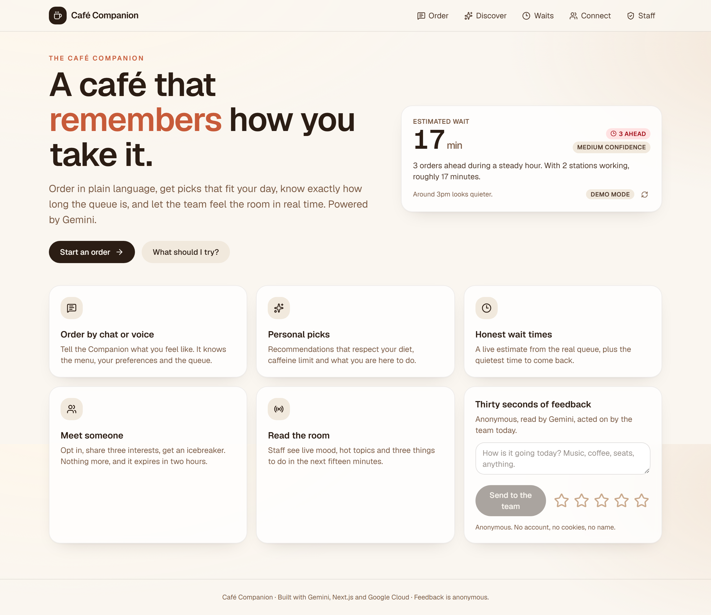
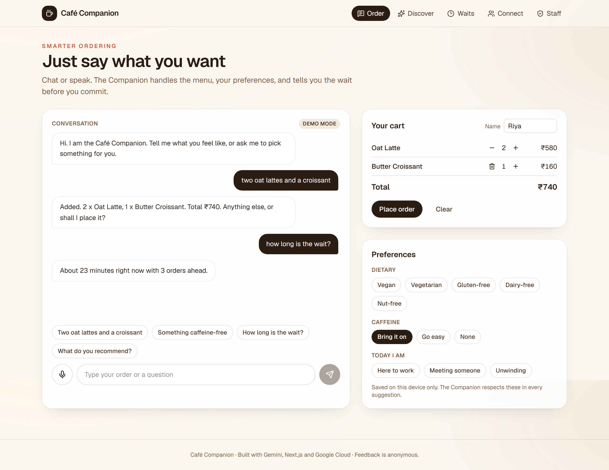
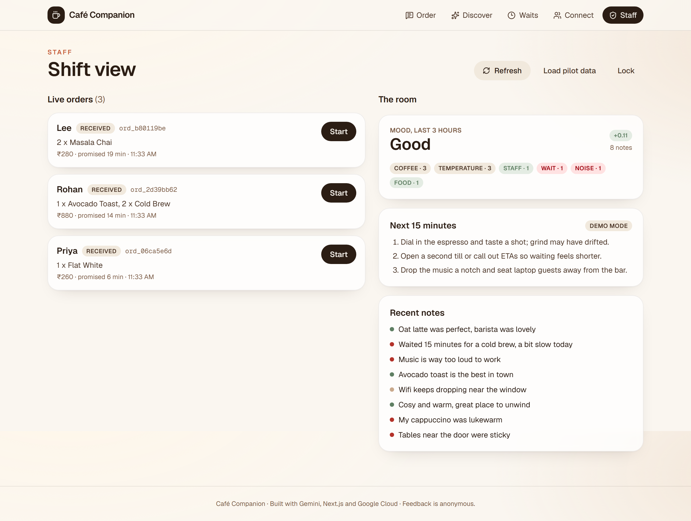
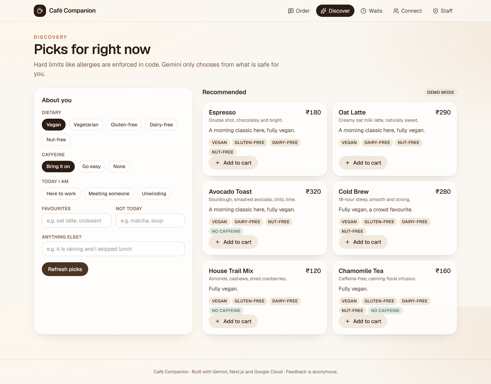

# The Café Companion

A smarter café experience powered by Gemini. Built for the Google Cloud Builder Pop-Up challenge.

Customers order in plain language or by voice, get picks that respect their diet and their day, see an honest wait time from the real queue, and can opt in to meet someone over coffee. The café team gets a live read of the room: mood, hot topics, and three things to do in the next fifteen minutes.

| Brief theme | What we built | Where |
|---|---|---|
| Smarter Ordering | Gemini tool-calling agent that searches the menu, edits the cart, checks the wait and places the order. Voice input in Chrome. | `/order` |
| Better Waits | Deterministic queue model (prep minutes per item across two stations) narrated by Gemini, plus the quietest time to come back and live order tracking. | `/waits` |
| Discovery | Preference-aware recommendations. Allergies and caffeine limits are enforced in code; Gemini chooses only from safe candidates and explains why. | `/discover` |
| Connect People | Opt-in, nickname-only profiles that expire in two hours. Jaccard matching on interests, Gemini icebreakers. | `/connect` |
| Understand the Room | Anonymous feedback classified for sentiment, topic and urgency. Staff dashboard with mood, topics, urgent flags and coaching suggestions. | `/feedback`, `/staff` |
| Surprise us | Everything degrades gracefully: without a Gemini key the app runs in a fully functional deterministic demo mode, so tests are free and the pilot never shows a blank screen. | `mode` badge on every AI answer |

## Screenshots

| Home with live wait | Chat ordering |
|---|---|
|  |  |

| Staff shift view | Discover (vegan filter) |
|---|---|
|  |  |

## Google technology used

- **Gemini API** (`@google/genai`, model `gemini-3.8-flash` by default, free of charge on the standard tier) for conversation with function calling, structured JSON output, classification and copywriting.
- **Firestore** (Firebase Spark free tier) for persistence in production, with an in-memory store for development.
- **Cloud Run** supported through the multi-stage `Dockerfile`; **Firebase App Hosting** through `apphosting.yaml`.
- Hosting for the free deployment is **Vercel Hobby**; see [docs/DEPLOYMENT.md](docs/DEPLOYMENT.md).
- **Chrome Web Speech API** for voice ordering.

## Quick start

```bash
pnpm install
cp .env.example .env.local        # add GEMINI_API_KEY, or leave empty for demo mode
pnpm dev                          # http://localhost:3000
```

Staff view: open `/staff`, PIN `2468` (change `STAFF_PIN`), then click **Load pilot data**.

## Scripts

| Command | What it does |
|---|---|
| `pnpm dev` / `pnpm build` / `pnpm start` | Next.js lifecycle |
| `pnpm check` | lint, typecheck and unit tests |
| `pnpm test:unit` | Vitest: pure logic, API route handlers, components |
| `pnpm test:e2e` | Playwright journeys on desktop and mobile (build first) |
| `pnpm docker:build && pnpm docker:run` | Run the production container locally on 8080 |

## Project layout

```
src/app            pages and API routes (App Router)
src/lib/ai         ordering agent, recommend, waits, sentiment, connect (each with demo fallback)
src/lib/store      Store interface, MemoryStore, FirestoreStore
src/lib/security   rate limiter, input hygiene, injection screen
src/components     UI
tests/unit         Vitest     tests/e2e  Playwright
docs               analysis, architecture, UX, testing, pilot, deployment
.claude/skills     run, test, deploy, security-check, pilot-report
```

## Documentation

- [Problem analysis and product decisions](docs/ANALYSIS.md)
- [Architecture](docs/ARCHITECTURE.md)
- [UX principles and accessibility](docs/UX.md)
- [Testing strategy](docs/TESTING.md)
- [Pilot test plan](docs/PILOT.md)
- [Deployment](docs/DEPLOYMENT.md)
- [Security and privacy](SECURITY.md)

## License

MIT. See [LICENSE](LICENSE).
